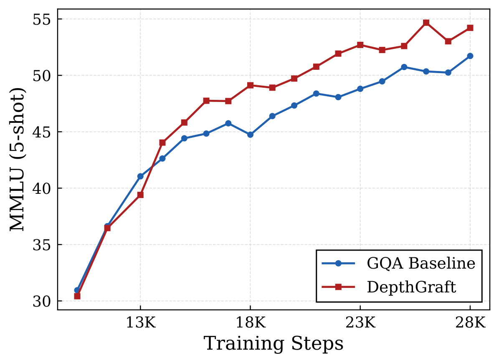
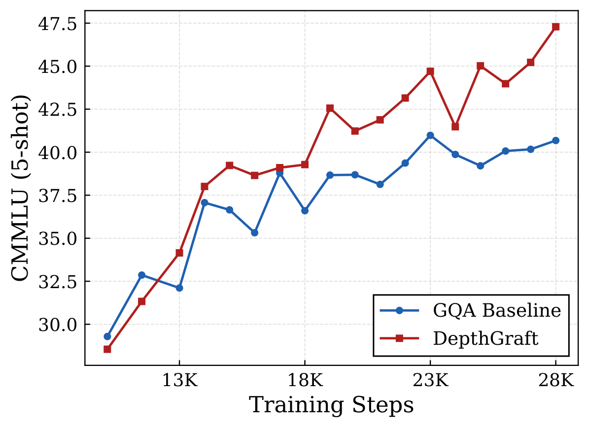
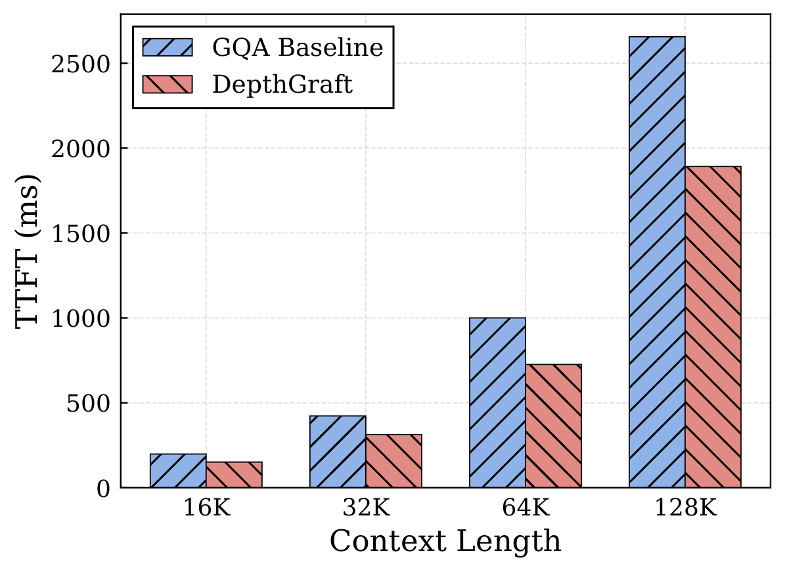
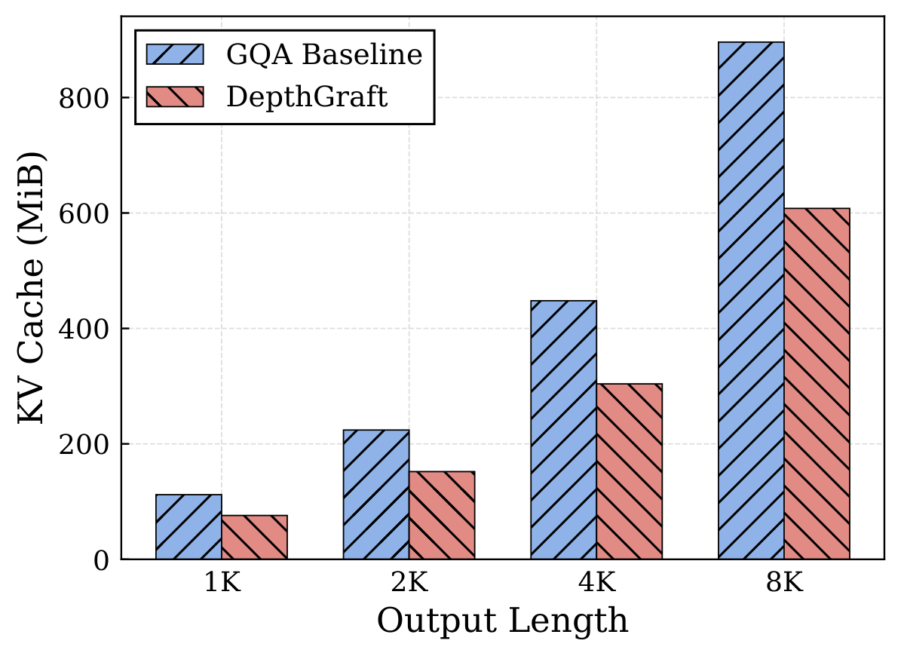
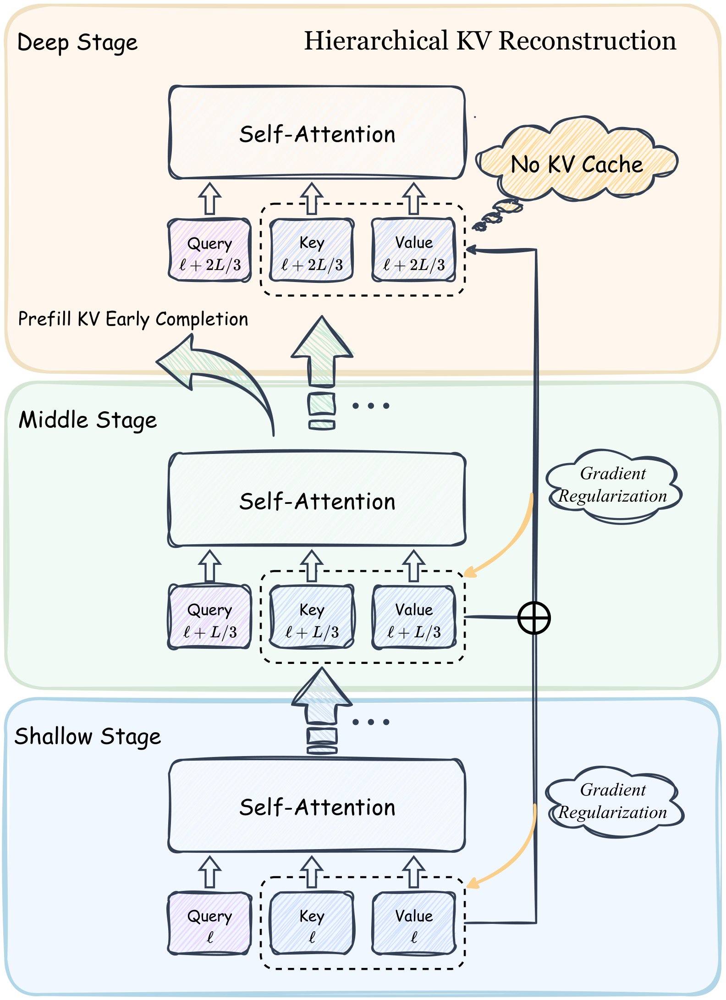
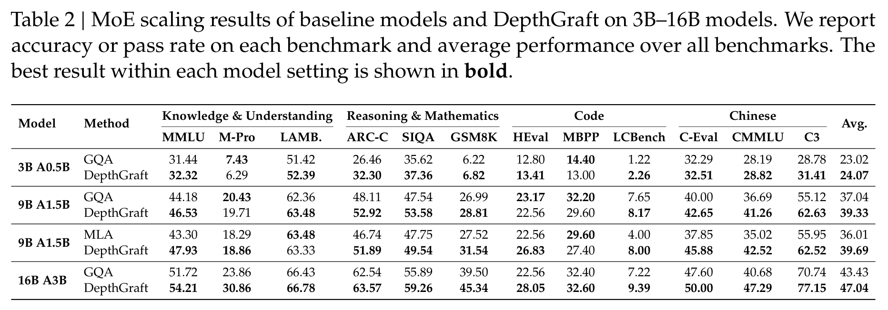
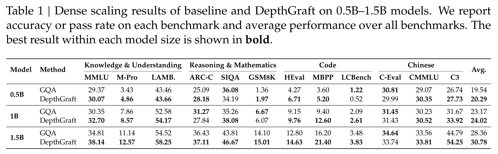
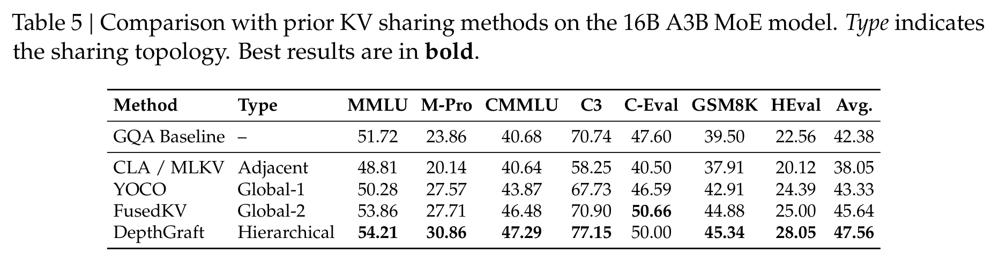
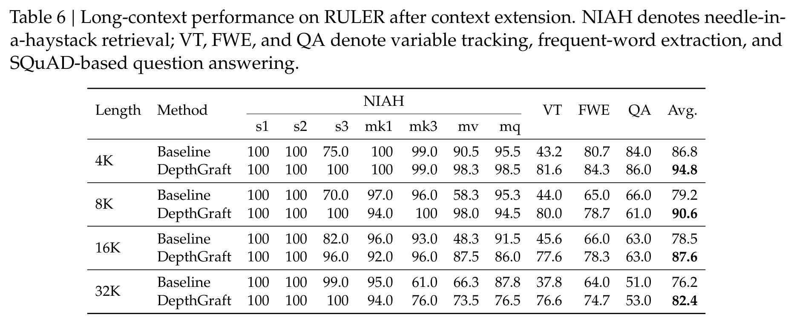

<h1 align="center">DepthGraft: Structural Regularization through Hierarchical Cross-Layer KV Reconstruction</h1>

<p align="center">
  NeurIPS 2026
</p>

<p align="center">
  Xiaohan Qin<sup>1,2,3</sup>, Xiangdong Zhang<sup>1,3</sup>, Yu Wang<sup>3</sup>,
  Huaijin Wu<sup>1,3</sup>,<br>
  Zhuo Xia<sup>1,3</sup>, Yebin Yang<sup>1,3</sup>, Junchi Yan<sup>1,&dagger;</sup>
</p>

<p align="center">
  <sup>1</sup>School of AI, Shanghai Jiao Tong University &nbsp;
  <sup>2</sup>Shanghai Innovation Institute<br>
  <sup>3</sup>Dots Studio, Xiaohongshu Inc.<br>
  <sup>&dagger;</sup>Corresponding author
</p>

<p align="center">
  <a href="https://arxiv.org/abs/2611.03142"><b>arXiv</b></a> &nbsp;|&nbsp;
  <a href="paper/DepthGraft.pdf"><b>PDF</b></a> &nbsp;|&nbsp;
  <a href="#overview">Overview</a> &nbsp;|&nbsp;
  <a href="#results">Results</a> &nbsp;|&nbsp;
  <a href="#efficiency">Efficiency</a> &nbsp;|&nbsp;
  <a href="#citation">Citation</a>
</p>

**DepthGraft reconstructs deep-layer keys and values from stride-aligned shallow and middle layers, improving model quality while reducing KV-cache storage and prefill cost.** Cross-layer KV reuse is not only a cache-saving mechanism: it also creates direct gradient paths that let deep layers shape earlier memory representations.

- **Stronger downstream performance:** average scores improve across dense and MoE models from **0.5B to 16B**, under both GQA and MLA. On the 16B MoE model, the average increases from **43.43 to 47.04 (+3.61)**, including **+7.00** on MMLU-Pro, **+6.61** on CMMLU, and **+6.41** on C3.
- **Smaller KV cache:** approximately **one-third less KV-cache storage**, with no independent KV cache in the deep stage.
- **Faster prefill:** at 128K context length, time to first token is reduced by **28.8%** on 16B GQA and **26.8%** on 9B MLA, with less than **1%** time-per-output-token overhead in the reported settings.

<table>
  <tr>
    <td align="center" width="25%"><a href="assets/pdf/mmlu_16b.pdf"></a></td>
    <td align="center" width="25%"><a href="assets/pdf/cmmlu_16b.pdf"></a></td>
    <td align="center" width="25%"><a href="assets/pdf/prefill_latency.pdf"></a></td>
    <td align="center" width="25%"><a href="assets/pdf/kv_cache.pdf"></a></td>
  </tr>
  <tr>
    <td align="center">MMLU</td>
    <td align="center">CMMLU</td>
    <td align="center">Prefill latency</td>
    <td align="center">KV-cache memory</td>
  </tr>
</table>

## Overview

KV sharing changes both the forward memory path and the backward training path. When a deep layer reuses earlier KV, its gradients also reach the source projections. The placement of these connections determines which source layers receive additional training signals.

DepthGraft organizes the network into three stages:

1. **Compute source memory.** The shallow and middle stages compute their own keys and values.
2. **Reconstruct deep-layer KV.** Each deep layer combines a shallow source and a middle source at the same relative depth, using learnable channel-wise coefficients.
3. **Distribute cross-layer gradients.** Stride-aligned source pairs spread the backward connections across source layers instead of concentrating them on a few anchors.

<p align="center">
  <a href="assets/pdf/architecture.pdf"></a>
</p>

Once the shallow and middle stages have processed a prompt, all KV sources needed for decoding are available. The deep stage then processes only the final prompt token to produce the first response, avoiding full-prompt computation in those layers.

## Results

### Dense and MoE Pre-training

The average covers 12 benchmarks in knowledge and understanding, reasoning and mathematics, code, and Chinese language understanding. DepthGraft improves the average at every evaluated model setting.

| Model | Attention | Baseline | DepthGraft | Gain |
| :--- | :--- | ---: | ---: | ---: |
| 0.5B Dense | GQA | 19.54 | **20.29** | +0.75 |
| 1B Dense | GQA | 23.17 | **24.02** | +0.85 |
| 1.5B Dense | GQA | 28.36 | **30.78** | +2.42 |
| 3B A0.5B MoE | GQA | 23.02 | **24.07** | +1.05 |
| 9B A1.5B MoE | GQA | 37.04 | **39.33** | +2.29 |
| 9B A1.5B MoE | MLA | 36.01 | **39.69** | +3.68 |
| 16B A3B MoE | GQA | 43.43 | **47.04** | +3.61 |

Detailed MoE results from Table 2 of the paper:

<p align="center">
  <a href="assets/pdf/moe_results.pdf"></a>
</p>

<details>
<summary><b>Full dense-model results</b></summary>

<p align="center">
  <a href="assets/pdf/dense_results.pdf"></a>
</p>

</details>

### Cross-Layer Connectivity

Ablations separate forward KV reuse from its backward gradient path. Under the same three-stage layout, enabling gradients through shallow-source reuse improves the seven-benchmark average from **42.86 to 45.30**. Hierarchical shallow-middle reconstruction further increases it to **47.56**.

DepthGraft also achieves the highest average among the evaluated adjacent-sharing and global-anchor KV-sharing methods in the matched 16B A3B comparison:

<p align="center">
  <a href="assets/pdf/kv_sharing_comparison.pdf"></a>
</p>

### Long-Context Evaluation

After the same 32K context extension, DepthGraft improves the RULER average at all four evaluated lengths. At **32K**, the average increases from **76.2 to 82.4**, including variable tracking from **37.8 to 76.6**.

<details>
<summary><b>RULER results from 4K to 32K</b></summary>

<p align="center">
  <a href="assets/pdf/ruler_results.pdf"></a>
</p>

</details>

## Efficiency

DepthGraft retains KV for approximately two-thirds of the layers. At 128K context length:

| Model | Baseline TTFT | DepthGraft TTFT | Reduction |
| :--- | ---: | ---: | ---: |
| 9B MLA | 611.19 ms | **447.51 ms** | **26.8%** |
| 16B GQA | 2655.90 ms | **1891.80 ms** | **28.8%** |

Time per output token remains within 1% of the baseline across the reported 8K-128K settings. The paper includes the full measurements and discusses prefill early completion and pipeline-parallel placement of source and reuse layers.

## Citation

```bibtex
@misc{qin2026depthgraft,
  title={DepthGraft: Structural Regularization through Hierarchical Cross-Layer KV Reconstruction},
  author={Xiaohan Qin and Xiangdong Zhang and Yu Wang and Huaijin Wu and Zhuo Xia and Yebin Yang and Junchi Yan},
  year={2026},
  eprint={2611.03142},
  archivePrefix={arXiv},
  primaryClass={cs.CL},
  url={https://arxiv.org/abs/2611.03142}
}
```

## Contact

For questions about the paper, please contact [galaxy-1@sjtu.edu.cn](mailto:galaxy-1@sjtu.edu.cn).
